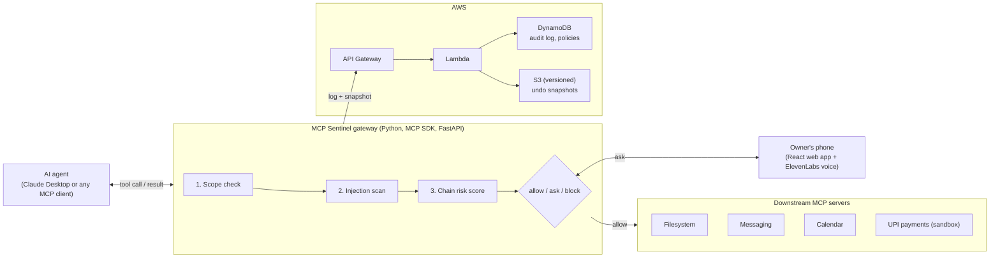
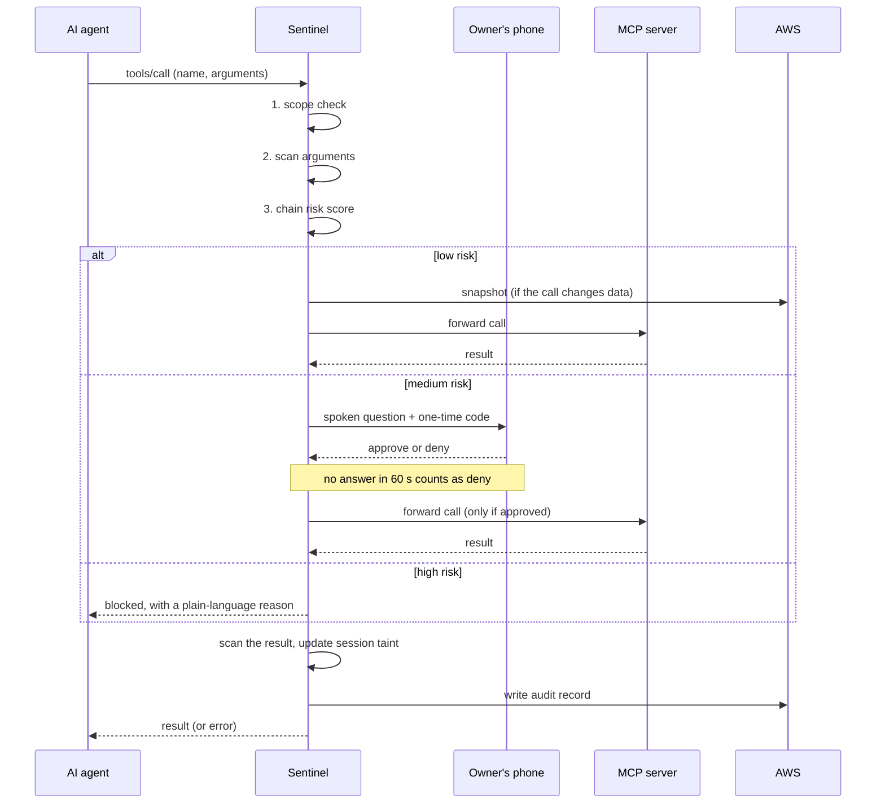

# MCP Sentinel: Architecture

> Status: design blueprint for wHACKiest 2026, Round 1. Nothing here is implemented yet. Numbers such as risk weights and timeouts are starting values that we will tune during the build.

## 1. What Sentinel is

MCP Sentinel is a gateway that sits between an AI agent and the MCP servers it uses. The agent connects to Sentinel as if it were a single MCP server. Sentinel connects to the real servers as an MCP client. Every tool call and every tool result passes through it.

Because Sentinel speaks plain MCP on both sides, neither the agent nor the downstream servers need code changes. The only change for the user is one line in the agent's MCP config: point it at Sentinel instead of at each server.

## 2. Components



| Component | Built with | Job |
|---|---|---|
| Gateway | Python, official MCP SDK, FastAPI | Proxies `tools/list` and `tools/call`, runs the three checks, enforces the decision |
| Policy store | DynamoDB | Per-tool permission scopes and pinned tool descriptions |
| Injection scanner | Rule patterns, plus an LLM judge on Amazon Bedrock for unclear cases | Flags hidden instructions in tool results and tool descriptions |
| Risk scorer | Python, in-memory session state | Scores each call using the history of the whole session |
| Voice approval | ElevenLabs text-to-speech and Scribe speech-to-text | Asks the owner in Hindi, Kannada or English and reads the reply |
| Phone app | React web app (PWA) | Approval screen, activity feed, Undo button, permission switches |
| Audit and undo | API Gateway, Lambda, DynamoDB, S3 versioning | Records every decision, stores snapshots for rollback |

MCP servers used in the prototype: Filesystem, a messaging server (Gmail or WhatsApp), Google Calendar, and our own sandbox UPI payment server. The UPI server is a mock. No real money moves.

## 3. Request flow



Step by step:

1. **Listing tools.** When the agent asks for `tools/list`, Sentinel collects the lists from all downstream servers, scans each tool description, and compares its hash with the pinned copy (section 6). Tools the owner has denied are not shown to the agent at all.
2. **Scope check.** For each `tools/call`, Sentinel looks up the tool's scope. A denied tool or an argument outside the scope's limits stops here.
3. **Injection scan.** The call arguments are scanned. After the call runs, the result is scanned too, before the agent sees it.
4. **Chain risk score.** The call is scored using what has already happened in this session.
5. **Decision.** Allow, ask the owner by voice, or block.
6. **Snapshot and log.** Before any call that changes data, a snapshot is saved. Every decision is written to the audit log.

## 4. Permission scopes

Each tool has a scope that the owner sets in the phone app. The app shows these as plain-language switches; the stored form looks like this:

```yaml
filesystem.read_file:
  mode: allow
  paths: ["~/Shop/invoices", "~/Shop/ledger"]

filesystem.delete_file:
  mode: ask

messaging.send_message:
  mode: ask
  known_contacts_only: true

upi.send_payment:
  mode: ask
  max_amount_inr: 2000        # above this: block
  daily_total_inr: 10000
  known_payees_only: false

calendar.delete_event:
  mode: deny
```

`mode` is the floor, not the final answer. The risk score can raise `allow` to `ask` or `block`. It can never lower `ask` or `deny`. A new tool that has no scope yet defaults to `ask`.

## 5. Risk scoring

The score is a simple sum so that every decision can be explained to the owner in one sentence.

| Factor | Points |
|---|---|
| Tool type: read | 0 |
| Tool type: write or modify | 2 |
| Tool type: send a message | 3 |
| Tool type: pay or delete | 4 |
| Session is tainted (the agent has read untrusted content: a file, email, web page or message from outside) | +2 |
| New recipient or payee, never used before | +1 |
| Amount above the owner's usual range | +2 |
| Arguments contain sensitive data (contacts, account numbers, canary records) | +2 |
| Injection scanner flagged this call or a recent result | +2 |

| Score | Decision |
|---|---|
| 0 to 3 | Allow silently |
| 4 to 7 | Ask the owner by voice |
| 8 or more | Block and notify |

Worked examples:

- Read an invoice file: 0. Allowed.
- Add a calendar event: 2. Allowed, snapshot taken.
- Pay a known supplier ₹800: 4. Owner is asked.
- After reading a poisoned invoice, pay ₹5,000 to a new UPI ID: 4 + 2 + 1 = 7. Owner is asked, and the question says the payee is new.
- After reading an outside email, send the contact list to a new address: 3 + 2 + 1 + 2 = 8. Blocked.

Some conditions block regardless of score: a scope of `deny`, a tool whose description changed since it was pinned, or a canary record appearing in outbound arguments.

The LLM judge is only called when the rule patterns are unsure. Its verdict can add points. It can never subtract them, so tricking the judge cannot make a call safer than the rules say it is.

## 6. Tool description pinning

The first time a tool appears, Sentinel shows the owner its description and stores a SHA-256 hash once the tool is approved. On every later `tools/list`, the hash is recomputed. If the description has changed, the tool is disabled until the owner approves it again. This stops a server from behaving well at install time and changing its instructions later.

## 7. Voice approval flow

1. Sentinel builds a short sentence from the call: who, what, how much, and why it was flagged. Example: "Your assistant wants to send ₹5,000 to a new payee, Ravi Traders. Say four-seven to approve."
2. ElevenLabs text-to-speech plays it on the owner's phone in their chosen language. The same text is shown on screen.
3. The owner answers aloud. ElevenLabs Scribe transcribes the reply. The screen also has Approve and Deny buttons as a fallback for noisy places.
4. The two-digit code is random, valid for one request, and expires after 60 seconds. A recording of an earlier approval cannot approve a new request.
5. No answer, a wrong code, or an unclear reply all count as deny.

The agent never sees the code and has no tool that can reach the approval channel.

## 8. Rollback

Before a call that changes data, Sentinel saves the state that is about to change:

| Action | Snapshot | Undo |
|---|---|---|
| Write or delete a file | Previous file contents, to a versioned S3 bucket | Restore the previous version |
| Change or delete a calendar event | Previous event as JSON | Recreate or restore the event |
| Send a message | Not reversible | Held until approved |
| Make a payment | Not reversible | Held until approved |

Undo is honest about its limits. Payments and sent messages cannot be taken back, so they are never executed without approval. Undo covers data changes only.

## 9. Audit log

One record per tool call, stored in DynamoDB:

```json
{
  "session_id": "s-2026-11-27-0012",
  "ts": "2026-11-27T10:42:07+05:30",
  "tool": "upi.send_payment",
  "arguments_summary": {"payee": "ravi@upi", "amount_inr": 5000},
  "risk_score": 7,
  "risk_factors": ["pay", "tainted_session", "new_payee"],
  "decision": "ask",
  "approval": {"channel": "voice", "result": "denied", "latency_ms": 6400},
  "snapshot_ref": null,
  "result": "not_executed"
}
```

Arguments are summarised, not stored in full, so the log does not become a second copy of the owner's private data. The phone app's activity feed reads from this table.

## 10. What is in the 24-hour build

In scope: the gateway in front of three servers (files, messaging, sandbox UPI), scopes, rule-based scanner, risk scorer, voice approval, audit log, undo for file changes, and ten scripted attacks.

Out of scope for the prototype: calendar undo, the LLM judge beyond a basic call, multi-user approval, and languages other than Hindi, Kannada and English.
